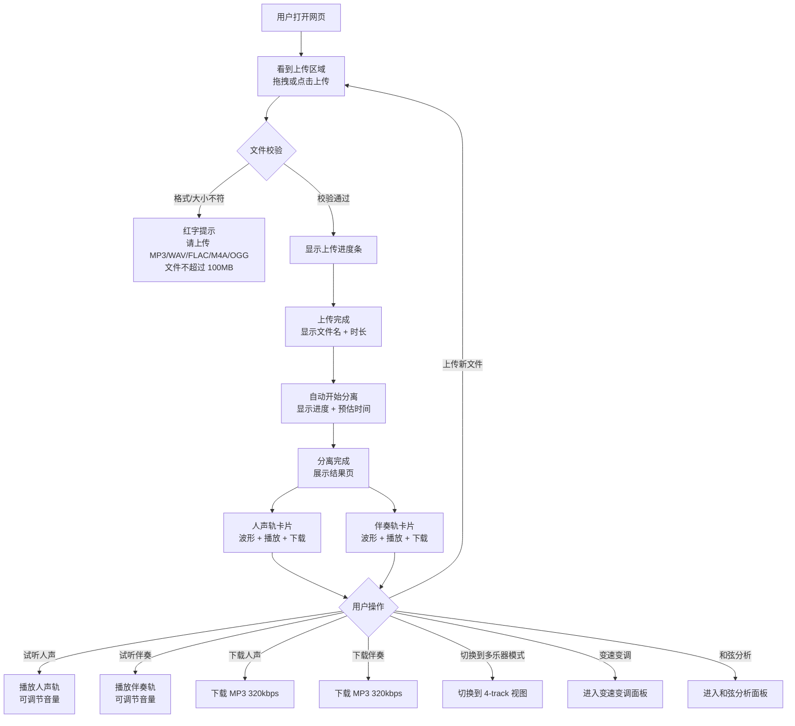

# 音频分离 Web 应用 — 产品需求文档（PRD）

> **版本**：v1.1
> **日期**：2026-06-02
> **作者**：req-agent
> **状态**：待李振远确认
> **变更**：v1.1 — 移除次要用户「王老师」画像，F-08 场景调整为翻唱曲库准备

---

## 目录

1. [项目背景与目标](#1-项目背景与目标)
2. [目标用户](#2-目标用户)
3. [功能范围](#3-功能范围)
4. [业务流程](#4-业务流程)
5. [非功能需求](#5-非功能需求)
6. [验收标准汇总](#6-验收标准汇总)
7. [风险与假设](#7-风险与假设)
8. [Out of Scope（本期不做）](#8-out-of-scope本期不做)
9. [附录](#9-附录)

---

## 1. 项目背景与目标

### 1.1 背景

音乐爱好者和非专业音乐人在日常中经常遇到以下场景：

- 想翻唱一首歌，但找不到纯伴奏版本
- 想学一首歌的吉他/钢琴部分，但原曲各乐器混在一起听不清
- 想跟着原曲练习，但原曲速度太快或调不合适
- 想知道一首歌的和弦走向，方便扒谱或即兴演奏

市面上已有 Moises.ai、LALAL.AI、VocalRemover.org 等产品，但它们普遍存在两个问题：
- **要么太专业**（满屏参数让小白不知所措）
- **要么太简陋**（只能做人声分离，无法满足多乐器分离、变速变调、和弦分析等进阶需求）

本项目的定位是：**在「简单好用」和「功能齐全」之间找到最佳平衡点**，为中文用户打造一个免费的音频处理工具。

### 1.2 项目目标

| 维度 | 目标 |
|------|------|
| **核心价值** | 让非专业音乐人轻松完成伴奏提取、音轨分离、变速变调、和弦分析 |
| **产品定位** | 免费、小白友好、功能全面的 Web 音频处理工具 |
| **上线标准** | P0 + P1 功能完整可用，处理质量对标 VocalRemover.org |
| **商业模式** | 当前完全免费；架构预留未来增值扩展空间 |

### 1.3 对标产品参考

| 产品 | 借鉴点 | 差异化 |
|------|--------|--------|
| **VocalRemover.org** | 极简交互、打开即用 | 我们增加多乐器分离、和弦分析、变速变调 |
| **Moises.ai** | 全能型功能矩阵 | 我们简化到核心场景，去掉专业参数面板 |
| **LALAL.AI** | 高精度分离质量 | 使用开源 SOTA 模型 Demucs，质量有保障 |
| **SplitSong** | 小白友好 | 我们在此基础上增加变速变调和和弦分析 |

---

## 2. 目标用户

### 2.1 用户画像

#### 主要用户：音乐爱好者「小艾」

| 属性 | 描述 |
|------|------|
| **年龄** | 18-35 岁 |
| **身份** | 学生/上班族，非音乐专业 |
| **音乐水平** | 会一点乐器（吉他/钢琴入门），能看懂简谱或六线谱，但乐理知识不系统 |
| **使用场景** | 周末在家录翻唱、跟着原曲扒吉他 Solo、想学某首歌但找不到教学视频 |
| **设备** | Windows 笔记本或台式机，Chrome/Edge 浏览器 |
| **痛点** | |
| | 1. 想翻唱但找不到伴奏，自己用 Audacity 扣又扣不干净 |
| | 2. 扒 Solo 时整首歌混在一起，反复拖进度条听到崩溃 |
| | 3. 原曲太快跟不上，想慢放但网上工具要么付费要么难用 |
| | 4. 不知道一首歌的和弦是什么，网上搜的谱经常不准 |
| **习惯** | 用 B站/抖音 看音乐教程，用全民K歌/唱吧录翻唱，习惯网页工具（不想装软件） |

### 2.2 核心使用场景

| 编号 | 场景 | 用户故事 | 驱动优先级 |
|------|------|---------|-----------|
| **S-A** | 翻唱录制 | "我想翻唱《晴天》，需要一个干净的伴奏，然后录自己的声音" | P0 |
| **S-B** | 扒谱/学乐器 | "我想学《加州旅馆》的吉他 Solo，希望把吉他音轨单独提出来听清楚" | P0 |
| **S-C** | 变速变调练习 | "我是男声想唱女声的歌，需要降 3 个调；或者某段 Solo 太快，想放慢到 70% 速度跟练" | P1 |
| **S-D** | 和弦分析 | "我听到一首好听的歌，想知道它的和弦进行，方便我弹唱" | P1 |

---

## 3. 功能范围

### 优先级定义

| 优先级 | 含义 | 上线要求 |
|--------|------|---------|
| **P0** | 核心功能，没有它产品不可用 | MVP 必须全部完成 |
| **P1** | 重要功能，显著提升产品价值 | MVP 必须全部完成 |
| **P2** | 锦上添花，增强用户粘性 | 首版尽量完成，时间不够可延期 |
| **P3** | 未来规划，架构预留 | 首版不做 |

---

### 3.1 P0 — 核心功能（MVP 必有）

#### F-01 音频文件上传

| 属性 | 内容 |
|------|------|
| **对应场景** | 所有场景的入口 |
| **功能描述** | 用户上传音频文件到平台进行处理。支持拖拽上传和点击选择。 |
| **验收标准** | |
| | AC-01-1: 支持 MP3、WAV、FLAC、M4A (AAC)、OGG 五种格式 |
| | AC-01-2: 文件大小上限 100MB（约 10 分钟 320kbps MP3 或 8 分钟无损） |
| | AC-01-3: 支持从本地点击选择文件上传 |
| | AC-01-4: 支持拖拽文件到上传区域 |
| | AC-01-5: 上传进度条显示百分比和速度 |
| | AC-01-6: 上传前客户端校验格式和大小，不合规即时提示 |
| | AC-01-7: 上传失败（网络中断等）时给出明确提示和重试按钮 |
| **交互要点** | 页面打开后最显眼的就是上传区，一句话说明"上传一首歌，开始处理" |

#### F-02 人声与伴奏分离（2-track）

| 属性 | 内容 |
|------|------|
| **对应场景** | S-A 翻唱录制 |
| **功能描述** | 将上传的音频分离为人声（Vocals）和伴奏（Instrumental）两轨。 |
| **验收标准** | |
| | AC-02-1: 处理完成后展示两个音轨：人声 + 伴奏 |
| | AC-02-2: 每个音轨支持独立在线播放试听 |
| | AC-02-3: 每个音轨支持单独下载（保持原格式，MP3 输出 320kbps） |
| | AC-02-4: 分离质量：主观听感上人声残留 < 5%（对标 Demucs HT 模型效果） |
| | AC-02-5: 处理进度实时显示（进度条 + 预估剩余时间） |
| | AC-02-6: 处理完成给出明确提示（音效/视觉反馈） |
| | AC-02-7: 80MB 文件在标准服务器（T4 GPU）上处理时间 < 3 分钟 |
| **交互要点** | 处理中显示"正在分离中...预计还需 X 分钟"，完成后两轨并排展示波形或简洁的卡片 |

#### F-03 多乐器音轨分离（4-track / Demucs 默认）

| 属性 | 内容 |
|------|------|
| **对应场景** | S-B 扒谱/学乐器 |
| **功能描述** | 将音频分离为 4 个独立音轨：人声（Vocals）、鼓（Drums）、贝斯（Bass）、其他（Other — 吉他/钢琴/弦乐等）。 |
| **验收标准** | |
| | AC-03-1: 输出 4 个音轨：人声、鼓、贝斯、其他（含吉他、钢琴、弦乐等） |
| | AC-03-2: 每个音轨支持在线播放试听 |
| | AC-03-3: 每个音轨支持单独下载 |
| | AC-03-4: 每个音轨支持独立音量调节（在线混音试听） |
| | AC-03-5: 分离质量能达到 Demucs HT 模型的基准水平 |
| | AC-03-6: 顶栏或侧栏可切换"人声/伴奏模式"和"多乐器模式" |
| **交互要点** | 默认展示人声/伴奏分离（2-track），一键切换到"多乐器模式"看到 4 轨 |

---

### 3.2 P1 — 重要功能（首版必有）

#### F-04 音频变速

| 属性 | 内容 |
|------|------|
| **对应场景** | S-C 变速变调练习 |
| **功能描述** | 对分离后的任意音轨或原始音频调整播放速度，范围 50% ~ 150%，不改变音高。 |
| **验收标准** | |
| | AC-04-1: 速度调整范围 50% ~ 150%，步长 5% |
| | AC-04-2: 改变速度不改变音高（Time-Stretch 算法） |
| | AC-04-3: 实时预听变速效果（无需重新处理整首） |
| | AC-04-4: 支持预设按钮：0.5x、0.75x、1x、1.25x、1.5x |
| | AC-04-5: 变速后音轨可下载 |
| | AC-04-6: 变速控制与播放器联动，调速时正在播放的音频立即生效 |
| **交互要点** | 一个滑块 + 几个快捷按钮即可，不要手填百分比 |

#### F-05 音频变调

| 属性 | 内容 |
|------|------|
| **对应场景** | S-C 变速变调练习 |
| **功能描述** | 对分离后的任意音轨或原始音频进行升降调调整，范围 -12 ~ +12 半音，不改变速度。 |
| **验收标准** | |
| | AC-05-1: 变调范围 -12 ~ +12 半音（即 ±1 个八度），步长 1 半音 |
| | AC-05-2: 改变音高不改变速度 |
| | AC-05-3: 实时预听变调效果 |
| | AC-05-4: 支持预设按钮：-5、-3、0、+3、+5（对应常见转调需求） |
| | AC-05-5: 变调后音轨可下载 |
| | AC-05-6: 变速和变调可以同时使用 |
| **交互要点** | 变速下面紧接着就是变调，同一个面板，同样滑块 + 快捷按钮 |

#### F-06 和弦识别与分析

| 属性 | 内容 |
|------|------|
| **对应场景** | S-D 和弦分析 |
| **功能描述** | 自动识别音频中的和弦进行，以时间轴形式展示和弦名称，并支持导出和弦谱。 |
| **验收标准** | |
| | AC-06-1: 支持对上传音频（或分离后的"其他"音轨）进行和弦识别 |
| | AC-06-2: 结果以时间轴展示：时间点 + 和弦名称（如 C, Am, G7） |
| | AC-06-3: 和弦展示支持两种记法切换：字母标记（C/Dm/Em）+ 数字级数（I/ii/iii） |
| | AC-06-4: 点击某个和弦可跳转到对应时间点播放 |
| | AC-06-5: 支持和弦谱导出（纯文本，格式如 "C - Am - F - G" 按段落排列） |
| | AC-06-6: 主流流行歌曲和弦识别准确率 > 80%（基于 Madmom/CREPE 方案的行业基准） |
| **交互要点** | 和弦分析作为处理完成后的一个 Tab 或按钮触发，不是默认操作，避免干扰只想做分离的用户 |

#### F-07 在线播放与波形可视化

| 属性 | 内容 |
|------|------|
| **对应场景** | 所有场景的试听环节 |
| **功能描述** | 分离/处理完成后，提供统一的音频播放控件，带波形可视化，支持多轨同步播放。 |
| **验收标准** | |
| | AC-07-1: 每个音轨展示波形图 |
| | AC-07-2: 点击波形可跳转播放位置 |
| | AC-07-3: 多轨模式下，所有音轨波形同步滚动 |
| | AC-07-4: 每个音轨可独立静音/独奏（Solo/Mute） |
| | AC-07-5: 全局播放控制：播放/暂停、快进/快退 5 秒 |
| | AC-07-6: 播放器响应式设计，手机浏览器也能基本操作（不是主要场景，但不应崩坏） |
| **交互要点** | 波形图是关键，让用户"看到"音乐；每个音轨左侧有音轨名称 + Solo/Mute 按钮 |

---

### 3.3 P2 — 增强功能（首版尽力）

#### F-08 批量上传与队列处理

| 属性 | 内容 |
|------|------|
| **对应场景** | 用户想一次处理多首歌曲（如准备翻唱曲库） |
| **功能描述** | 支持一次上传多个音频文件，排队处理，无需等待上一首完成再上传下一首。 |
| **验收标准** | |
| | AC-08-1: 单次最多上传 5 个文件 |
| | AC-08-2: 自动排队处理，FIFO 顺序 |
| | AC-08-3: 队列列表展示每个文件的状态（等待中/处理中/已完成/失败） |
| | AC-08-4: 已完成的任务结果保留（会话有效期内），可随时切换查看 |
| **交互要点** | 上传完成后自动加入队列，不要弹窗确认；队列在侧边栏展示 |

#### F-09 历史记录

| 属性 | 内容 |
|------|------|
| **对应场景** | 用户想找回之前处理过的歌 |
| **功能描述** | 在当前浏览器存储最近处理过的音频列表，方便回溯。 |
| **验收标准** | |
| | AC-09-1: 基于浏览器 localStorage / IndexedDB，最近 10 条记录 |
| | AC-09-2: 记录包含：歌曲名（文件名）、处理时间、处理类型 |
| | AC-09-3: 点击历史记录可回看之前的分离结果（若文件仍在本地缓存中） |
| | AC-09-4: 支持清除历史记录 |
| | AC-09-5: 不需要登录/注册，纯本地 |
| **交互要点** | 放在页面右上角的小图标里，不打扰主流程 |

#### F-10 MP3 格式输出选项

| 属性 | 内容 |
|------|------|
| **对应场景** | 用户需要特定码率的文件 |
| **功能描述** | 下载时可选输出格式和码率。默认统一输出为 MP3 320kbps。 |
| **验收标准** | |
| | AC-10-1: 下载音轨时可选择 MP3（128/192/320kbps）或 WAV |
| | AC-10-2: 默认 MP3 320kbps |
| | AC-10-3: 下载前显示文件大小预估 |

---

### 3.4 P3 — 未来规划（本期不做，架构预留）

| 编号 | 功能 | 说明 |
|------|------|------|
| F-11 | 用户账号系统 | 注册/登录，云端历史记录同步 |
| F-12 | 本地录音 | 网页端直接录制翻唱，与伴奏叠加 |
| F-13 | MIDI 导出 | 和弦/Melody 转 MIDI |
| F-14 | 节拍/BPM 检测 | 自动检测歌曲 BPM，配合节拍器练习 |
| F-15 | AI 扒谱（旋律转简谱/五线谱） | 从音频直接生成乐谱 |
| F-16 | 视频音频提取 | 上传视频文件，提取音频后分离 |
| F-17 | 专业参数调节面板 | 高级分离参数（FFT 窗口大小、分离强度等） |
| F-18 | 分享功能 | 生成分享链接，把处理结果发给朋友 |

---

## 4. 业务流程

### 4.1 主流程：人声/伴奏分离



### 4.2 子流程：多乐器分离

```mermaid
flowchart TD
    A[用户在结果页] --> B[点击"多乐器模式"]
    B --> C[显示 4 个音轨：<br/>人声 / 鼓 / 贝斯 / 其他]
    C --> D[每个音轨可：<br/>独奏 Solo / 静音 Mute / 调节音量]
    D --> E[用户可随时切回<br/>人声/伴奏 2-track 视图]
    D --> F[每个音轨支持<br/>单独下载]
```

### 4.3 子流程：变速变调

```mermaid
flowchart TD
    A[用户在结果页] --> B[展开"变速变调"面板]
    B --> C[速度滑块 50%~150%<br/>预设: 0.5x 0.75x 1x 1.25x 1.5x]
    B --> D[音调滑块 -12~+12<br/>预设: -5 -3 0 +3 +5]
    C --> E[实时预听<br/>拖动滑块立即生效]
    D --> E
    E --> F{满意?}
    F -->|是| G[下载变速/变调后音轨]
    F -->|否| H[继续调整]
    H --> E
```

### 4.4 子流程：和弦分析

```mermaid
flowchart TD
    A[用户在结果页] --> B[点击"和弦分析"]
    B --> C[系统分析音频<br/>显示进度]
    C --> D[展示和弦时间轴]
    D --> E[时间点 + 和弦名列表]
    E --> F{用户操作}
    F -->|切换记法| G[字母 C/Am/G7 ↔ 级数 I/vi/V7]
    F -->|点击和弦| H[跳转到对应时间播放]
    F -->|导出| I[下载纯文本和弦谱]
    F -->|重新分析| C
```

---

## 5. 非功能需求

### 5.1 性能

| 指标 | 目标值 | 备注 |
|------|--------|------|
| 首屏加载时间 | < 3 秒（4G 网络） | 前端 SPA，按需加载 |
| 文件上传速度 | 取决于用户带宽，不做限制 | 服务端不做限速 |
| 2-track 分离时间 | 80MB 文件 < 3 分钟 | T4 GPU，Demucs HT |
| 4-track 分离时间 | 80MB 文件 < 5 分钟 | T4 GPU，Demucs HT |
| 和弦分析时间 | 80MB 文件 < 2 分钟 | CPU 密集型，可用 GPU 加速 |
| 变速/变调处理 | < 30 秒（实时预听 < 1 秒响应） | 预听用轻量算法，导出用高质量 |
| API 响应时间（非 AI） | P95 < 200ms | |

### 5.2 文件格式与大小

| 项目 | 规格 | 理由 |
|------|------|------|
| **输入格式** | MP3, WAV, FLAC, M4A (AAC), OGG | 覆盖 95%+ 常见音频格式 |
| **输入大小上限** | 100MB | 约 10 分钟 320kbps MP3，覆盖绝大多数流行歌曲 |
| **输入时长上限** | 15 分钟 | 超出提示"暂不支持超过 15 分钟的音频" |
| **输出格式** | MP3 320kbps（默认） | 音质与文件大小的平衡 |
| **输出归档** | 单轨下载 / 打包下载（ZIP） | 多轨时打包为 ZIP |
| **采样率** | 统一处理为 44100Hz | Demucs 默认采样率 |

### 5.3 安全

| 项目 | 要求 |
|------|------|
| **文件传输** | HTTPS 加密传输 |
| **文件存储** | 处理后 24 小时自动删除 |
| **上传校验** | 服务端二次校验 MIME 类型和文件头魔数，防止非音频文件上传 |
| **文件访问** | 随机 Token URL，不可遍历 |
| **速率限制** | 单 IP 每小时最多处理 20 次请求，防止滥用 |
| **依赖安全** | Python 依赖定期扫描漏洞，模型文件校验 SHA256 |
| **前端安全** | 防范 XSS，使用 DOMPurify 处理用户输入的显示 |

### 5.4 兼容性

| 项目 | 要求 |
|------|------|
| **浏览器** | Chrome 90+, Edge 90+, Firefox 90+, Safari 15+ |
| **操作系统** | Windows 10+, macOS 11+, Linux（主流发行版） |
| **移动端** | 不做重点适配，但布局不崩坏，播放器基本可用 |
| **屏幕分辨率** | 最小宽度 1024px（平板横屏）；最佳体验 1280px+ |

### 5.5 可用性

| 项目 | 要求 |
|------|------|
| **语言** | 简体中文（首版不做国际化） |
| **无障碍** | 不做（首版不涉及） |
| **错误处理** | 所有错误以中文提示，给出操作建议（不是技术错误码） |
| **加载状态** | 所有异步操作有加载状态指示 |
| **空状态** | 首次进入页面展示引导性上传区，不是空白页 |
| **帮助/引导** | 上传区旁边有一个"？"图标，悬停展示支持的功能和格式 |

### 5.6 部署与运维

| 项目 | 要求 |
|------|------|
| **部署方式** | Docker Compose（前端 Nginx + 后端 FastAPI + GPU Worker） |
| **GPU 需求** | 至少 1 张 T4（16GB 显存）用于 Demucs 推理 |
| **并发处理** | 单 GPU 同时处理 1 个任务（GPU 内存限制），排队机制 |
| **日志** | 结构化日志（JSON），方便后续排查 |
| **监控** | 基础健康检查端点 + 队列长度指标 |

---

## 6. 验收标准汇总

### 6.1 MVP（P0 + P1）验收 Checklist

```
□ F-01  用户能上传 MP3/WAV/FLAC/M4A/OGG 格式音频，最大 100MB
□ F-01  拖拽上传和点击上传均可正常使用
□ F-01  格式/大小不合规时即时提示
□ F-02  上传后自动开始人声/伴奏分离
□ F-02  分离完成后人声和伴奏可独立试听和下载
□ F-02  分离质量主观听感上人声残留少，伴奏干净
□ F-02  进度条和预估时间准确（误差 < 30%）
□ F-03  可切换到多乐器模式，看到 4 个音轨
□ F-03  每个音轨可独奏/静音/调音量
□ F-03  每个音轨可单独下载
□ F-04  变速范围 50%~150%，不改变音高
□ F-04  预设按钮和滑块均可用
□ F-04  实时预听可用
□ F-05  变调范围 -12~+12 半音，不改变速度
□ F-05  变速和变调可同时使用
□ F-06  和弦分析结果以时间轴展示
□ F-06  支持和弦谱导出
□ F-06  字母记法和级数记法可切换
□ F-07  每个音轨有波形图，点击可跳转
□ F-07  多轨播放同步
□ 所有操作有加载状态或进度提示
□ 所有错误以中文友好提示
□ HTTPS 全站加密
□ 处理完成 24 小时后文件自动清理
```

---

## 7. 风险与假设

### 7.1 核心假设

| 编号 | 假设 | 如果假设不成立的影响 | 验证方式 |
|------|------|---------------------|---------|
| A-01 | Demucs HT 模型可在 T4 GPU 上以 < 5 分钟处理 80MB 音频 | 处理太慢用户流失 | MVP 开发阶段先跑 Benchmark |
| A-02 | 用户愿意等待 3-5 分钟处理时间 | 需要在体验上做更多优化（如后台通知） | 上线后看用户留存数据 |
| A-03 | 和弦识别（Madmom/CREPE）在流行歌曲上准确率 > 80% | 和弦功能用户不买账 | 找 20 首中文流行歌做内部测试 |
| A-04 | 单 GPU 排队机制在日活 < 500 时够用 | 需要扩展 GPU 或优化推理 | 上线后监控队列长度 |
| A-05 | 用户主要用电脑浏览器访问 | 移动端体验差导致流失 | 看 Google Analytics 设备占比 |
| A-06 | 免费模式下日处理量可控在 GPU 预算内 | 成本过高需要引入付费或限流 | 预估算单次处理成本（T4 约 $0.4/h，一次 4-track 约 $0.03） |

### 7.2 已知风险

| 编号 | 风险 | 概率 | 影响 | 缓解措施 |
|------|------|------|------|---------|
| R-01 | GPU 服务器成本超出免费模式承受力 | 中 | 高 | 架构预留限流/排队；若量上来，可先加广告或引入"免费排队 / 付费优先" |
| R-02 | 版权问题（用户上传盗版音乐处理） | 中 | 中 | 作为工具提供方，不存储原始文件，24h 自动清理，声明用户自行负责版权 |
| R-03 | 分离质量不满足用户预期（特别是一些编曲复杂的歌曲） | 中 | 中 | 明确告知用户"效果取决于原曲混音方式"，后续可选更高质量模型 |
| R-04 | 网络环境差导致上传失败或等待超时 | 低 | 低 | 断点续传（P2），上传失败重试机制 |
| R-05 | 竞品（Moises/LALAL.AI）持续迭代拉大差距 | 低 | 中 | 专注中文用户和免费定位，节奏跟随开源模型进步 |

---

## 8. Out of Scope（本期不做）

| 项目 | 原因 |
|------|------|
| 用户注册/登录 | P3，首版纯免费免登录 |
| 移动端 App（iOS/Android） | 明确不做，Web 即可 |
| 社区功能（分享、评论、点赞） | 明确不做 |
| 支付/付费体系 | P3，免费优先 |
| 国际化/多语言 | 首版仅简体中文 |
| 离线使用（PWA Service Worker） | P3，首版纯在线 |
| 视频处理（提取音频） | P3 |
| 无障碍（ARIA） | P3 |
| 自定义 AI 模型切换 | P3 |
| API 对外开放 | P3 |
| 协作/多人功能 | 不在规划中 |

---

## 9. 附录

### 9.1 技术架构概要（供后续 arch-agent 参考）

```
┌──────────────────────────────────┐
│        CDN / Nginx 静态托管       │
│   React SPA (Vite + TypeScript)  │
└──────────────┬───────────────────┘
               │ HTTPS
┌──────────────▼───────────────────┐
│     FastAPI 后端 (Python 3.11+)  │
│  ┌─────────────────────────────┐ │
│  │  /api/upload     上传接口   │ │
│  │  /api/separate   分离接口   │ │
│  │  /api/chords     和弦接口   │ │
│  │  /api/download   下载接口   │ │
│  └──────────┬──────────────────┘ │
│             │                    │
│  ┌──────────▼──────────────────┐ │
│  │  Redis 任务队列              │ │
│  │  - 分离任务排队              │ │
│  │  - 状态查询                  │ │
│  └──────────┬──────────────────┘ │
└─────────────┼────────────────────┘
              │
┌─────────────▼────────────────────┐
│  GPU Worker (独立进程/容器)       │
│  ┌─────────────────────────────┐ │
│  │  Demucs HT 模型             │ │
│  │  - 2-track (人声/伴奏)      │ │
│  │  - 4-track (人声/鼓/贝斯/其他)│ │
│  ├─────────────────────────────┤ │
│  │  和弦识别 (CREPE / Chordino) │ │
│  ├─────────────────────────────┤ │
│  │  音频处理 (librosa/soundfile)│ │
│  │  - 变速 (Time-Stretch)      │ │
│  │  - 变调 (Pitch-Shift)       │ │
│  └─────────────────────────────┘ │
└──────────────────────────────────┘
```

### 9.2 参考模型

| 用途 | 推荐模型 | 备选 |
|------|---------|------|
| 音频分离（2-track / 4-track） | Demucs HT（Hybrid Transformer） | Spleeter（更快但质量略低） |
| 和弦识别 | CREPE + Chordino（Madmom 生态） | Chordify 开源方案 |
| 变速/变调 | librosa time_stretch + pitch_shift | pyrubberband（更高质量） |

### 9.3 页面结构草图（供后续 ui-agent 参考）

```
┌────────────────────────────────────────────┐
│  Logo          音频分离工具          [历史]  │  ← 顶栏
├────────────────────────────────────────────┤
│                                            │
│     ┌──────────────────────────┐           │
│     │                          │           │  ← 上传区（初始状态）
│     │   🎵  拖拽音频文件到此处   │           │
│     │      或点击选择文件       │           │
│     │                          │           │
│     │  支持 MP3/WAV/FLAC/M4A/   │           │
│     │  OGG，最大 100MB          │           │
│     └──────────────────────────┘           │
│                                            │
├────────────────────────────────────────────┤  ← 结果区（处理完成后）
│  [人声/伴奏] [多乐器模式]                   │  ← 模式切换
│                                            │
│  ┌──────────────────────────────────────┐  │
│  │ 🎤 人声  ─────────波形──────────  🔇  │  │  ← 音轨 1
│  │           ▶ 00:00 / 04:32    ⬇下载   │  │
│  ├──────────────────────────────────────┤  │
│  │ 🎸 伴奏  ─────────波形──────────  🔇  │  │  ← 音轨 2
│  │           ▶ 00:00 / 04:32    ⬇下载   │  │
│  └──────────────────────────────────────┘  │
│                                            │
│  [变速变调]  [和弦分析]                      │  ← 扩展功能区
│                                            │
│  速度: [0.5x] [0.75x] [●1x] [1.25x] [1.5x]│  ← 变速变调面板
│  音调: [-5]  [-3]   [●0]  [+3]   [+5]     │
│                                            │
├────────────────────────────────────────────┤
│  Footer: 关于 | 反馈 | 隐私政策             │
└────────────────────────────────────────────┘
```

---

> **下一步**：李振远确认 PRD 后，由 arch-agent 进行架构设计。
> **维护者**：req-agent
> **最后更新**：2026-06-02

---

# 附录 A：P001 经验教训（复盘）

> 来源：2026-06-24 全量审查 + P001 复盘。原计划写在 .claude/memory/p001-lessons-learned.md，该目录未被 git 跟踪（.claude/* 被忽略），故并入本 PRD 附录长期保存。

## A.1 核心结论

**测试通过 ≠ 可以交付。** P001 在测试全绿的情况下仍暴露出线上问题，因此公司在 CLAUDE.md §4.5 新增了「④.5 稳定化阶段」。稳定化阶段的规则如下：

| 规则 | 要求 |
|------|------|
| Docker 实跑验证 | 在 Docker 中实际运行 ≥ 24h，确认无内存泄漏、进程退出 |
| 边界场景测试 | 大文件 / 空文件 / 并发请求 / 断网恢复 |
| 跨平台验证 | Dockerfile 在 Linux 目标平台正常构建（非仅开发机） |
| 修复后回归 | 稳定化中修复的 Bug 必须重跑全量测试 |
| Claude 终审 | 稳定化通过后终审，确认无遗留 |

## A.2 安全与配置教训

1. **禁止硬编码凭据**：数据库密码、SECRET_KEY 一律走 .env，模板里留空并在启动时校验非空。
2. **.claude/ 目录不入库**：会话状态、settings.local 含本地路径与个人信息。
3. **CORS_ORIGINS 用 JSON 数组**表示，不要用逗号分隔字符串（解析歧义导致过宽放行）。

## A.3 流程教训

1. **强制 Subagent 模式**（CLAUDE.md §4.4）：协调者不能自演 Agent，否则产出无法独立审计。
2. **大文档增量写入**：先骨架再逐节写，避免一次写几万字导致上下文溢出。
3. **状态文件要单一权威**：P001 曾出现 3 份互相矛盾的进度文档，接管时判断成本极高 —— 游戏产品线已按此整改为「一份权威路线图」。

## A.4 改进落地情况

| 改进项 | 落地位置 | 状态 |
|--------|---------|------|
| 稳定化阶段 | CLAUDE.md §4.5 | ✅ |
| 强制 Subagent | CLAUDE.md §4.4 | ✅ |
| 项目文件隔离 | CLAUDE.md §7.3 | ✅ |
| 单一权威路线图 | .claude/docs/game-development-roadmap.md | ✅ |
| 自动化 hook 可用性 | .claude/docs/automation-setup.md | ✅（2026-11-24 改为 PowerShell） |